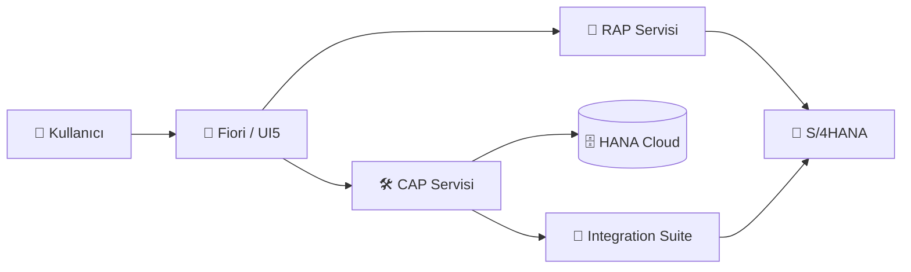

# ✨ FioriSS ✨

### SAP Solutions | Building Smarter Software.

---

## 🚀 Biz Kimiz?

FioriSS, **SAP ekosisteminde** modern, bulut odaklı ve **Clean Core** uyumlu çözümler geliştirir.
Standart SAP'yi bozmadan, yan tarafta (side-by-side) ve in-app olarak genişletiriz.

## 🧭 Uzmanlık Alanlarımız

| | Alan | Ne yapıyoruz? |
|---|---|---|
| ☁️ | **SAP BTP** | Cloud Foundry, Kyma, Destination, Connectivity, Cloud Connector, XSUAA / IAS |
| 🧱 | **ABAP RAP** | Managed & Unmanaged senaryolar, Draft, Behavior Definition, CDS View Entity, Business Events |
| 🛠️ | **CAP** | CDS modelleme, Node.js / Java servisler, OData V4, Multitenancy, MTA deploy |
| 🎨 | **Fiori / SAPUI5** | Fiori Elements, Freestyle UI5, Launchpad, Work Zone, Business Application Studio |
| 🧼 | **ABAP Cloud** | Clean Core, released API'ler, Key User Extensibility, Developer Extensibility |
| 🔌 | **Entegrasyon** | Integration Suite, OData / REST / SOAP, Event Mesh, API Management |
| 🤖 | **Otomasyon** | SAP Build Process Automation, Build Apps, Build Work Zone |
| 🗄️ | **Veri** | SAP HANA Cloud, CDS, Datasphere, HDI konteynerleri |

## 🏗️ Mimari Yaklaşımımız

## 🧰 Teknoloji Yığını

-326CE5?style=for-the-badge&logo=kubernetes&logoColor=white)

<b>📚 Sık kullandığımız SAP araçları</b>

- **ABAP Development Tools (ADT)**: Eclipse üzerinde RAP / ABAP Cloud geliştirme
- **SAP Business Application Studio**: CAP ve Fiori geliştirme ortamı
- **SAP BTP Cockpit**: Subaccount, entitlement ve servis yönetimi
- **Cloud Transport Management**: Ortamlar arası taşıma
- **ABAP Test Cockpit & ABAP Unit**: Kalite ve test
- **Fiori Tools**: Application Generator, Page Editor, Guided Development

<b>🧠 Geliştirme prensiplerimiz</b>

- **Clean Core**: Standart koda dokunmadan genişletme
- **API-first**: Released API ve event tabanlı mimari
- **Güvenlik**: Rol bazlı yetkilendirme, en az yetki ilkesi
- **Otomasyon**: CI/CD, otomatik test ve taşıma
- **Dokümantasyon**: Anlaşılır, sürdürülebilir kod

## 📬 İletişim

- 🌐 Web: [alihaydarsayar.com](https://alihaydarsayar.com/)
- 💬 SAP projeniz mi var? Web sitemizden bize ulaşın.

**Building Smarter SAP Solutions** 💙

